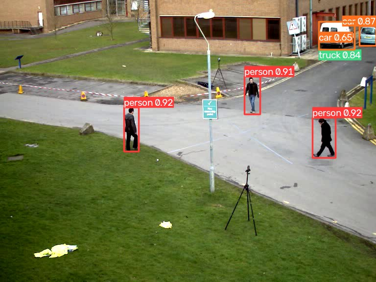

<div align="center">

# easydetect

**Easy real-time object detection you can actually ship.**
Train in PyTorch, run anywhere with OpenVINO — CPU, GPU or NPU — and label,
train and test in a browser. Apache-2.0 code and weights.

[](https://pypi.org/project/easydetect/)
[](https://pypi.org/project/easydetect/)
[](https://github.com/themakerrobot/easydetect/blob/main/LICENSE)
[](https://github.com/themakerrobot/easydetect/actions/workflows/ci.yml)



</div>

## Why

* **Three lines to a detector.** `Detector("ed-s")`, point it at a picture,
  read the boxes. The same object trains, validates and exports.
* **A permissive licence.** Apache-2.0 code, Apache-2.0 COCO weights (from
  D-FINE's), Apache-2.0 exports: no copyleft that makes a product publish its
  source. The data a model learned from keeps its own terms: COCO's annotations
  are CC BY 4.0 (keep the credit) and its pictures are under Flickr's terms, so
  check those before commercial use.
* **Accurate for its size.** The ed detectors are real-time DETRs: ed-s
  scores 48.5 COCO mAP with 10M parameters.
* **Runs on the machine you have.** OpenVINO runs it on a CPU, an Intel GPU or
  an Intel NPU; ONNX Runtime on any CPU, a Raspberry Pi included. No CUDA
  needed to deploy. A GPU makes training quick: an NVIDIA card, or an Intel
  GPU with PyTorch's XPU build.
* **No NMS to tune.** ed is trained to give each object one box. The odd
  second box on the same object — one vehicle as both truck and car — is
  dropped by a fixed overlap filter (IoU 0.7, any class), so there is no
  threshold to tune and a crowded frame costs no extra time.

## Install

```bash
pip install easydetect              # inference: OpenVINO and ONNX Runtime
pip install "easydetect[train]"     # + training (PyTorch)
```

Inference never needs PyTorch. Both runtimes come with the plain install and
return the same boxes; `Detector` uses OpenVINO unless you pass
`backend="onnxruntime"`. OpenVINO is the faster one on an Intel CPU (ed-s at
640 on a 4-core Xeon: 49 ms against 132 ms) and the only way to an Intel GPU or
NPU; ONNX Runtime is the smaller one, for a box where every megabyte counts:

```bash
pip install --no-deps easydetect && pip install numpy pyyaml opencv-python onnxruntime
```

## Detect

```python
from easydetect import Detector

model = Detector("ed-s")           # COCO weights, downloaded on first use
r = model("photo.jpg", conf=0.5)[0]

r.boxes.xyxy, r.boxes.conf, r.boxes.cls   # plain numpy
r.names[int(r.boxes.cls[0])]              # "person"
r.plot(); r.save(); r.show()
```

Point it at an image, a folder, a glob, a video, an RTSP stream, a webcam index,
or a numpy array. Long sources stream, so memory stays flat:

```python
for r in model.predict(0, stream=True, show=True):   # webcam, q or Esc quits
    print(r.boxes.xyxyn)

model.track("clip.mp4")        # adds r.boxes.id
model = Detector("ed-s", device="NPU")            # AUTO, CPU, GPU, NPU
```

A webcam viewer with an FPS counter is in [`examples/webcam.py`](https://github.com/themakerrobot/easydetect/blob/main/examples/webcam.py)
— `python examples/webcam.py --track`.

## Train

```python
model = Detector("ed-s")
model.train(data="data.yaml", epochs=50, imgsz=640, batch=16, device=0)
model.val(data="data.yaml").box.map50
model.export(format="openvino")       # best.xml + best.bin + labels.txt
```

```yaml
# data.yaml
path: /data/cans
train: images/train
val: images/val
names: {0: can, 1: bottle}
```

Labels are one `.txt` per image, `cls cx cy w h` normalised — the layout every
labelling tool already exports. A YOLO-format download (Roboflow's included)
trains as it comes; [training.md](https://github.com/themakerrobot/easydetect/blob/main/docs/training.md#datasets-from-elsewhere)
lists the variations it accepts. Training starts from the COCO weights and saves
an average of the weights (EMA) as the checkpoint; `freeze="backbone"` trains
faster on a small set, and `resume=True` picks a killed run back up with
the settings it had. A class named like one of COCO's (`apple`, `사과`) starts
from the row that already detects it.

## Label, train and watch it in a browser

[easydetect lab](https://github.com/themakerrobot/easydetect-lab) is a web app on top of this package, in its own
repository: drop images in, label them (the model drafts the boxes, you correct
them), queue a training run, watch the curve, then run the result over a folder,
a video or your webcam — on one machine, with nothing leaving it. A finished run
hands you copy-ready code and a Hugging Face folder whose model card is written
from the run.

```bash
git clone https://github.com/themakerrobot/easydetect-lab
cd easydetect-lab
pip install -r requirements.txt     # easydetect[train] from PyPI, and the web server
python run.py                       # http://<this machine>:8080
```


## Models

| name | backbone | params | COCO mAP50-95 |
| --- | --- | --- | --- |
| `ed-n` | HGNetv2-B0 | 4M | 42.8 |
| `ed-s` | HGNetv2-B0 | 10M | 48.5 — the default |
| `ed-m` | HGNetv2-B2 | 19M | 52.3 |
| `ed-l` | HGNetv2-B4 | 31M | 54.0 |
| `ed-x` | HGNetv2-B5 | 62M | 55.8 |

COCO numbers are the original authors' for these checkpoints (640 px, val2017).

### Trained on public datasets: easydetect hub

[easydetect hub](https://huggingface.co/leeyunjai/easydetect-hub) holds ed-s
trained on over a hundred public datasets (trash, plants, blood cells, safety
gear, documents, games, aerial and underwater pictures, COCO, Open Images,
LVIS...), each at 320 px (with an 8-bit file for a Raspberry Pi) and 640 px.
The weights are Apache-2.0, built from Apache-2.0 models; the training data's
terms still apply. Each dataset's licence and credit are shown with its models:
keep the credit, and check them before commercial use. Name one and it downloads
once, no PyTorch needed:

```python
model = Detector("hub:taco/ed-s-640")          # ONNX
model = Detector("hub:taco/ed-s-640.xml")      # OpenVINO IR, for an Intel NPU
model = Detector("hub:bccd/ed-s-320-int8")     # 8 bits, for a Raspberry Pi
model = Detector("hub:taco/ed-s-640.pt")       # the checkpoint, to fine-tune
```

`easydetect hub` lists them with their scores (`easydetect hub search=plant`).
A model's web address works too (a file, its Hugging Face page, or a hub
model's folder), as do relative and absolute paths.

## Speed

`ed-s` at 640 on one desktop — a Core Ultra 5 250K Plus with an RTX 5090 —
whole pipeline (resize, inference, decode), median of 30 calls, from
`python tools/bench.py`:

| `device=` | latency | FPS |
| --- | --- | --- |
| `"CPU"` | 36 ms | 28 |
| `"NPU"` | 38 ms | 26 — and the CPU stays free |
| `"GPU"` (the RTX 5090 through OpenCL) | 14 ms | 72 |

The GPU returns the CPU's boxes exactly, the NPU to a mean IoU of 0.98.
[performance.md](https://github.com/themakerrobot/easydetect/blob/main/docs/performance.md)
covers measuring your own machine and what makes it faster.

## Compared with YOLO

Published COCO val2017 numbers at 640 px, as each project reports them — not
re-measured here. Both models are NMS-free; YOLO26 also publishes a score
with NMS added, shown second.

| | n | s | m | l | x |
| --- | --- | --- | --- | --- | --- |
| ed mAP50-95 | **42.8** | **48.5** | 52.3 | 54.0 | 55.8 |
| YOLO26 mAP50-95 (no NMS / with NMS) | 40.1 / 40.9 | 47.8 / 48.6 | 52.5 / 53.1 | 54.4 / 55.0 | 56.9 / 57.5 |
| ed params | 4M | 10M | 19M | 31M | 62M |
| YOLO26 params | 2.4M | 9.5M | 20.4M | 24.8M | 55.7M |

Keypoints (OKS AP, COCO val2017, scored with pycocotools; the whole pipeline
— people found by the detector, then their keypoints):

| | s | m | l |
| --- | --- | --- | --- |
| easydetect (ed-s, then the keypoint model of that size) | **66.3** | **71.6** | **73.4** |
| YOLO26-pose | 63.0 | 68.8 | 70.4 |

Read it plainly:

* **Detection is a draw.** ed is ahead at the small sizes (n, s), YOLO26
  at the large ones (l, x), and lighter there.
* **Keypoints: easydetect is about 3 points ahead** at each size. The price is
  speed with crowds: YOLO26-pose places everyone's keypoints in one pass, here
  each person found is a second (small) pass.
* **Masks without mask labels.** YOLO-seg learns masks from polygon labels.
  Here `task="segment"` outlines whatever the detector finds — a model trained
  on boxes alone gets masks with no polygon drawn — and polygons, when you
  have them, fine-tune the mask decoder (COCO polygons: mean IoU 0.752 →
  0.810).
* **The licence.** Ultralytics YOLO is AGPL-3.0: a product that ships it, or
  serves it over a network, must publish its source or buy a commercial
  licence. The code and weights here are Apache-2.0, with no such condition;
  what remains is the training data's own terms (COCO: CC BY 4.0 annotations,
  pictures under Flickr's terms).
* **Where YOLO fits better:** pose and segmentation trained end to end, more
  tasks (oriented boxes, classification, depth), and a far larger ecosystem.

COCO is a guide, not your answer. What matters is the model you get from a
few hundred pictures of your own. `tools/bench_finetune.py` fine-tunes
ed (easydetect 0.7.5) and YOLO26 (Ultralytics 8.4) on the same public
datasets, each with its own trainer's defaults (100 epochs, 640 px, batch 16,
one RTX 5090), and scores both with one evaluator on the val split.
mAP50-95, YOLO26 → ed at each size:

| dataset | train pictures | n | s | m |
| --- | --- | --- | --- | --- |
| african-wildlife | 1,052 | 0.817 → **0.848** | 0.830 → **0.869** | 0.814 → **0.890** |
| construction-ppe | 1,132 | **0.300** → 0.293 | 0.289 → **0.297** | 0.298 → **0.307** |
| brain-tumor | 893 | 0.417 → **0.449** | 0.357 → **0.470** | 0.360 → **0.466** |
| signature | 143 | 0.975 → **0.985** | 0.984 → **0.985** | 0.967 → **0.997** |
| medical-pills | 92 | **0.797** → 0.794 | **0.801** → 0.800 | 0.797 → **0.812** |
| african-wildlife, 100 at random | 100 | 0.711 → **0.802** | 0.674 → **0.837** | 0.613 → **0.858** |
| a picture on the CPU (OpenVINO, Core Ultra 5 250K, 640 px) | | 8–9 → 10 ms | 23–25 → 28–32 ms | 66 → 55–65 ms |

* **ed is ahead on 15 of 18**; the three it is not are within 0.007
  (construction-ppe and medical-pills at n, medical-pills at s).
* **The fewer the pictures, the larger the lead:** on 100 pictures for four
  classes, +0.09 (n), +0.16 (s), +0.25 (m); on brain-tumor's two look-alike
  classes, +0.03 to +0.11.
* **Speed:** YOLO26 runs 15–25% faster at n and s; at m ed is the faster
  one. YOLO also trains faster.

Six datasets are few. `tools/rf100.py` repeats the comparison on 26 of
Roboflow 100's datasets across seven domains (aerial, video games,
microscopy, underwater, documents, X-ray and thermal, everyday objects), at
most 300 training pictures each, three seeds, scored on each test split:

| ed against YOLO26, same size | ed ahead on | mean | median |
| --- | --- | --- | --- |
| **s, 640 px, 100 epochs, each trainer's defaults** | **19 of 26** | **+0.019** | **+0.016** |
| n, 640 px, 100 epochs, each trainer's defaults | 8 of 26 | −0.034 | −0.018 |
| s, 320 px, the lab's classroom preset | 6 of 26 | −0.054 | −0.049 |
| n, 320 px, the lab's classroom preset | 4 of 26 | −0.103 | −0.076 |

* **ed-s at 640 is ahead** (19 of 26, the same in each seed's run): most
  where objects are large or must be told apart by shape (animals +0.20,
  underwater pipes +0.11, furniture +0.07).
* **Small objects are ed's weak side:** aerial pictures, game screens, road
  signs and parasites lose most, and more so at 320 px and with ed-n, which
  has no stride-8 feature map (ed-n: 16 and 32; ed-s: 8, 16 and 32).
* **The classroom preset is behind YOLO26n here.** It was tuned on three
  small datasets of large objects (the table below), where it is ahead; on
  small objects at 320 px it is not.
* mAP50-95 counts a box for every class it scores, as each project scores
  itself. Each cell is one run; how much a small dataset moves from one run to
  the next is measured below.

### Small inputs and small computers

On a Raspberry Pi the input shrinks to 320 px, and there the 640 px
COCO weights lose most of what they know. `tools/long_run.py` fine-tunes them
on COCO at the smaller size (with 100 decoder queries, which the Pi runs
faster) and scores everything here on all 5,000 val2017 pictures with one
evaluator — OpenVINO on the CPU, one class a box, up to 100 boxes a picture.
YOLO is Ultralytics' own export at each size. mAP50-95:

| input | ed-n, 640 px weights | ed-n, fine-tuned at that size | ed-s, 640 px weights | ed-s, fine-tuned at that size | YOLO11n | YOLO26n | YOLO11s | YOLO26s |
| --- | --- | --- | --- | --- | --- | --- | --- | --- |
| 320 | 0.100 | **0.322** | 0.239 | **0.381** | 0.283 | 0.297 | 0.365 | **0.381** |
| 640 | **0.416** | 0.410 | **0.472** | 0.465 | 0.381 | 0.397 | 0.453 | 0.471 |

Raspberry Pi 4B, 4 threads, `easydetect benchmark` (OpenVINO; a fine-tuned
model runs as fast as the original of the same size and queries):

| | 320 | 320, 100 queries | 640 |
| --- | --- | --- | --- |
| ed-n | 190 ms | **122 ms** | 479 ms |
| ed-s | 508 ms | 347 ms | 1,323 ms |

* **Fine-tune at the size you will run.** ed-n at 320: 0.100 → 0.322;
  ed-s at 320: 0.239 → 0.381. At 640 the original weights stay better.
* **Against YOLO at the same size:** ed-n is ahead of both YOLO n models at
  every size; ed-s matches YOLO26s at 320.
* **100 queries cost almost nothing** in accuracy (0.323 → 0.322 at 320) and
  save a third of the time on the Pi. Through ONNX Runtime, as the Pibo
  robot runs it, YOLO11s at 320 takes 300 ms on the same Pi and ed-s at 320
  with 100 queries 407 ms; Pibo runs ed-s for its accuracy.
* The fine-tuned 320 column was trained with 100 queries; 640
  with all 300 (it did not beat the original either way).
* `ed-n-320.pt` and `ed-s-320.pt` are on the mirror: a run at 320 px with at
  most 100 queries (`train(imgsz=320, queries=100)`) starts from them.
* Our evaluator puts ed-n at 640 at 0.416 where its authors report 42.8: one
  class a box and 100 boxes a picture count fewer boxes than COCO's own tool.

### Small datasets: run it more than once

A dataset with a few dozen val pictures moves by several points from one
run to the next, so `tools/long_run.py` trains every benchmark with three
seeds. ed-n against YOLO26n at 320 px, 30 epochs, batch 8 (easydetect
0.7.5, mean ± spread of three runs):

| dataset | train pictures | YOLO26n | ed-n |
| --- | --- | --- | --- |
| african-wildlife | 1,052 | 0.786 ± 0.007 | **0.812 ± 0.004** |
| construction-ppe | 1,132 | **0.270 ± 0.002** | 0.234 ± 0.004 |
| brain-tumor | 893 | 0.364 ± 0.005 | 0.365 ± 0.010 |
| signature | 143 | 0.957 ± 0.010 | 0.959 ± 0.009 |
| medical-pills | 92 | **0.754 ± 0.005** | 0.722 ± 0.003 |
| african-wildlife, 100 at random | 100 | **0.649 ± 0.004** | 0.572 ± 0.033 |

A small dataset wants more epochs. The lab's classroom settings — backbone
frozen, 100 queries — on the three smallest sets (YOLO26n with the same
epochs beside it):

| dataset | 30 epochs | 70 epochs | 100 epochs | YOLO26n, 100 epochs |
| --- | --- | --- | --- | --- |
| african-wildlife, 100 at random | 0.628 | 0.730 | **0.751** | 0.679 |
| signature | 0.885 | 0.938 | 0.960 | **0.976** |
| medical-pills | 0.554 | 0.693 | 0.746 | **0.780** |

So the lab's classroom preset picks the epochs from the dataset — about
1,000 steps, 35 epochs for 300 pictures up to 100 for a few dozen — which
keeps a laptop run near the same 10–15 minutes. It starts from `ed-n-320.pt`
with `freeze="auto"`: the backbone stays frozen when COCO knows one of the
classes and trains (800 steps) when it knows none. Three seeds each, YOLO26n
with the same epochs (on the datasets it was tuned on; across RF100's 26 it is
behind, see above):

| dataset | YOLO26n | ed-n, classroom |
| --- | --- | --- |
| african-wildlife, 100 at random | 0.668 | **0.733** |
| signature | 0.971 | **0.979** |
| medical-pills | 0.770 | **0.776** |

## Command line

```bash
easydetect predict model=ed-s source=photo.jpg conf=0.5
easydetect train   model=ed-s data=data.yaml epochs=50
easydetect val     model=best.pt data=data.yaml
easydetect export  model=best.pt format=openvino half=true
```

## Docs

* [Using the model](https://github.com/themakerrobot/easydetect/blob/main/docs/usage.md) — sources, results, tracking, saving
* [Training](https://github.com/themakerrobot/easydetect/blob/main/docs/training.md) — datasets, validation, export, CLI
* [easydetect lab](https://github.com/themakerrobot/easydetect-lab) — the browser app: labelling, jobs, sharing
* [Weights](https://github.com/themakerrobot/easydetect/blob/main/docs/weights.md) — the mirror, building it, offline use
* [Performance](https://github.com/themakerrobot/easydetect/blob/main/docs/performance.md) — measuring speed and improving it
* [Deploying](https://github.com/themakerrobot/easydetect/blob/main/docs/deploy.md) — an HTTP server, the `.onnx` contract, other runtimes
* [Design](https://github.com/themakerrobot/easydetect/blob/main/docs/design.md) — architecture and provenance
* [Development](https://github.com/themakerrobot/easydetect/blob/main/docs/contributing.md) — tests, releases

## What it does not do

Masks and keypoints come from separate models on the detector's boxes: masks
are not trained on your data, and keypoints are COCO's 17 for people only. No
classification. One training process, one
machine; multi-GPU and distributed training are out of scope. Inference runs on
OpenVINO or ONNX Runtime; for a CUDA deployment, take the exported ONNX to
TensorRT from there.

## 한국어

```python
from easydetect import Detector

model = Detector("ed-s")                # COCO 사전학습 가중치 자동 다운로드
model("photo.jpg", conf=0.5)[0].save()     # 결과 이미지 저장
model.train(data="data.yaml", epochs=50)   # 내 데이터로 학습
model.export(format="openvino")            # 배포용 IR + labels.txt
```

세 줄이면 물체 검출이 됩니다. 모델은 ed(실시간 DETR)이고, 코드와 가중치는
모두 Apache-2.0이라 AGPL처럼 소스를 공개해야 하는 조건이 없습니다. 다만 학습에 쓴
데이터의 조건은 따로 있습니다(COCO: 정답은 CC BY 4.0, 사진은 Flickr 약관). 출처를
표기하고, 상업적으로 쓰기 전에 그 조건을 확인하세요.

설치는 두 가지입니다. `pip install easydetect`는 추론용으로 OpenVINO와 ONNX
Runtime이 함께 들어가고 PyTorch는 없습니다. `pip install "easydetect[train]"`은
학습까지 합니다. 기본 엔진은 OpenVINO(인텔 CPU·GPU·NPU)이고,
`Detector("ed-s", backend="onnxruntime")`로 ONNX Runtime(모든 CPU, 라즈베리파이
포함)을 쓸 수 있습니다. 두 엔진의 결과는 같습니다.

공개 데이터셋 100여 개로 학습한 모델이 [easydetect hub](https://huggingface.co/leeyunjai/easydetect-hub)에
있습니다(쓰레기, 식물, 혈액세포, 안전장비, 문서, 게임, 항공·수중 사진, COCO, Open Images,
LVIS 등). 가중치는 Apache-2.0이고, 학습에 쓴 데이터셋의 조건(출처 표기 등)은 그대로
따릅니다. 표기를 지키고, 상업적으로 쓰기 전에 데이터셋과 사진의 조건을 확인하세요. `Detector("hub:taco/ed-s-640")`처럼 이름만
쓰면 한 번 내려받아 PyTorch 없이 돌고, `easydetect hub`로 목록과 점수를 봅니다.

라벨링부터 학습·추론까지 브라우저로 하려면 [easydetect lab](https://github.com/themakerrobot/easydetect-lab). 가중치 캐시는
`~/.easydetect/`, 사내 미러는 `EASYDETECT_ASSETS_URL` 환경변수로 지정합니다.

라즈베리파이처럼 작은 기기에서는 입력을 320으로 줄이는데, 640으로 학습된
COCO 가중치는 이 크기에서 성능이 크게 떨어집니다(ed-n 320: 0.100). 그 크기로
COCO를 다시 학습하면 0.322로 올라 같은 크기의 YOLO11n·YOLO26n보다 높고, 라즈베리파이
4B에서 쿼리 100개로 122밀리초입니다. 사진이 적은 데이터는 에폭을 늘릴수록 좋아져서
(100장: 30에폭 0.628 → 100에폭 0.751), easydetect lab의 수업용 설정은 데이터 크기에
맞춰 에폭을 정하고, COCO에 있는 물체면 백본을 고정합니다(`freeze="auto"`). 학습은
NVIDIA GPU나 인텔 GPU(XPU)에서도 됩니다.

Roboflow 100의 26개 데이터셋(데이터셋마다 학습 사진 최대 300장, 3번씩)에서 같은
크기의 YOLO26과 비교하면, ed-s를 640 px로 100에폭 학습했을 때 26개 중 19개에서
앞섭니다(평균 +0.019). 반면 작은 물체(항공 사진, 게임 화면, 도로 표지판)에는 약해서,
320 px 수업용 설정(ed-n)은 26개 중 4개에서만 앞섭니다. 자세한 표는 위의 "Compared
with YOLO", "Small inputs and small computers", "Small datasets" 절에 있습니다.

## Credits

The detector and its COCO weights come from
[D-FINE](https://github.com/Peterande/D-FINE) (Apache-2.0,
[arXiv:2410.13842](https://arxiv.org/abs/2410.13842)), which builds on
[RT-DETR](https://github.com/lyuwenyu/RT-DETR). This package adapts that network
and loss, and adds its own training loop, inference stack and tooling — see
[NOTICE](https://github.com/themakerrobot/easydetect/blob/main/NOTICE).

## License

Apache-2.0 — see [LICENSE](https://github.com/themakerrobot/easydetect/blob/main/LICENSE) and [NOTICE](https://github.com/themakerrobot/easydetect/blob/main/NOTICE).
The weights are Apache-2.0 too; the data they learned from keeps its own terms
(COCO: CC BY 4.0 annotations, pictures under Flickr's terms; each easydetect hub
dataset's are on its page).
